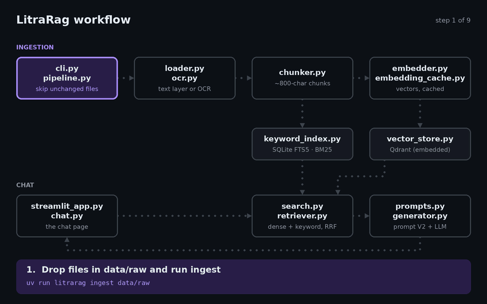

# LitraRag

[](https://github.com/NuhaKamal/LitraRag/actions/workflows/ci.yml)

**Ask questions about your own documents, running entirely on your machine.**

LitraRag is a local RAG (Retrieval-Augmented Generation) system. It reads your PDFs, scanned pages, photos of pages and text files, makes them searchable by meaning and by exact words, and answers questions with a local LLM, showing which file and page each answer came from.

No cloud services, no API keys: documents, vectors and models all stay on your computer.

## Features

- **Selective OCR**: typed PDF pages are read directly; only scanned pages go through Tesseract, in parallel
- **Hybrid search**: dense search by meaning (Qdrant + `nomic-embed-text`) fused with keyword search (SQLite FTS5 + BM25) using Reciprocal Rank Fusion
- **Grounded answers**: the LLM answers only from retrieved passages and says so when the documents don't contain the answer
- **Fast re-ingestion**: unchanged files are skipped by content hash, and every embedding is cached, so re-indexing an edited file costs seconds, not minutes
- **Streaming chat UI** in Streamlit, with sources and page numbers
- **Swappable parts**: every stage sits behind a `Protocol`; the LLM can run locally or on a remote GPU (e.g. Colab) by changing one setting

## How it works

<picture>
  <source media="(prefers-color-scheme: dark)" srcset="docs/workflow-dark.gif">
  
</picture>

```
INGESTION   uv run litrarag ingest data/raw
  file → loader (+ OCR) → chunker → cached embedder ─┬─▶ Qdrant (vectors)
                                                     └─▶ SQLite FTS5 (keywords)

CHAT        uv run streamlit run app/streamlit_app.py
  question → dense + keyword retrieval → RRF fusion → prompt → LLM → answer + sources
```

Ingestion **writes** the stores; the chat **reads** them.

## Requirements

| Tool | Purpose | Install (Windows) |
| --- | --- | --- |
| Python 3.12 | Runtime (installed automatically by uv) | — |
| [uv](https://docs.astral.sh/uv/) | Environment and package manager | `winget install astral-sh.uv` |
| [Tesseract](https://github.com/tesseract-ocr/tesseract) | OCR for scanned pages and images | `winget install UB-Mannheim.TesseractOCR`, then add `C:\Program Files\Tesseract-OCR` to PATH |
| [Ollama](https://ollama.com) | Runs the embedding model and the LLM | `winget install Ollama.Ollama` |

Tested on an 8 GB Windows laptop. Docker is **not** required: Qdrant runs in embedded mode.

## Installation

```bash
git clone https://github.com/NuhaKamal/LitraRag.git
cd LitraRag
uv sync

ollama pull nomic-embed-text   # embeddings (274 MB)
ollama pull llama3.2:1b        # chat model (~1.3 GB)
```

## Usage

**1. Add documents.** Put files in `data/raw/` (subfolders are fine).
Supported: `.pdf`, `.png`, `.jpg`, `.jpeg`, `.tif`, `.tiff`, `.bmp`, `.txt`, `.md`.

**2. Ingest them.** Make sure Ollama is running.

```bash
uv run litrarag ingest data/raw
```

```
Ingested 4 files in 254.9 s
  4 indexed, 0 unchanged, 0 failed, 888 chunks
  3.5 chunks/s while indexing
```

Run it again after adding or editing files: unchanged files are skipped.

**3. Chat.**

```bash
uv run streamlit run app/streamlit_app.py
```

Open `http://localhost:8501`.

> **Note:** embedded Qdrant allows one process at a time. Close the chat (`Ctrl+C`) before running `litrarag ingest`.

## Configuration

Every setting has a default in `src/litrarag/config.py` and can be overridden with an environment variable named `RAG_` + the setting name in capitals. Invalid values are rejected at startup with a clear message.

| Variable | Default | Meaning |
| --- | --- | --- |
| `RAG_LLM_URL` | `http://localhost:11434` | Ollama server for the LLM (local, or remote e.g. an ngrok URL to Colab) |
| `RAG_LLM_MODEL` | `llama3.2:1b` | Chat model |
| `RAG_EMBED_URL` | `http://localhost:11434` | Ollama server for embeddings |
| `RAG_EMBED_MODEL` | `nomic-embed-text` | Embedding model |
| `RAG_QDRANT_MODE` | `embedded` | `embedded` (a folder) or `server` (Docker) |
| `RAG_QDRANT_URL` | `http://localhost:6333` | Qdrant server, used in `server` mode |
| `RAG_TESSERACT_CMD` | *(find on PATH)* | Full path to `tesseract.exe` if it isn't on PATH |
| `RAG_CHUNK_SIZE` / `RAG_CHUNK_OVERLAP` | `800` / `100` | Chunk length and overlap, in characters |
| `RAG_TOP_K` | `4` | Chunks sent to the LLM per question |
| `RAG_OCR_DPI` | `200` | Resolution for rendering scanned pages |
| `RAG_MAX_WORKERS` | `4` | Parallel OCR workers |
| `RAG_EMBED_BATCH_SIZE` | `16` | Texts per embedding request |
| `RAG_LLM_NUM_CTX` | `2048` | LLM context window (more = more RAM) |
| `RAG_LLM_MAX_TOKENS` | `300` | Maximum answer length |
| `RAG_LOG_LEVEL` | `INFO` | `DEBUG`, `INFO`, `WARNING` or `ERROR` |

Example, using a larger model on a remote GPU (PowerShell):

```powershell
$env:RAG_LLM_URL = "https://your-name.ngrok-free.app"
$env:RAG_LLM_MODEL = "gemma2:9b-instruct-q5_0"
uv run streamlit run app/streamlit_app.py
```

## Project structure

```
src/litrarag/
├── config.py            settings + resource limits, from environment variables
├── logging_setup.py     console + rotating file logging, timing helper
├── schemas.py           every data shape passed between stages
├── protocols.py         the contract each swappable stage fulfils
├── ocr.py               Tesseract adapter: image → text + confidence
├── loader.py            file → Document; decides which pages need OCR
├── chunker.py           Document → Chunks (LangChain text splitter)
├── embedder.py          text → vectors via Ollama (LangChain)
├── embedding_cache.py   SQLite cache wrapping any embedder
├── vector_store.py      Qdrant adapter: store and search vectors
├── keyword_index.py     SQLite FTS5 adapter: BM25 keyword search
├── pipeline.py          ingestion composition root
├── cli.py               the `litrarag` command
├── retriever.py         dense, keyword and hybrid (RRF) retrievers
├── search.py            retrieval composition root
├── prompts.py           versioned prompt templates
├── generator.py         question + chunks → streamed answer (LangChain + Ollama)
└── chat.py              chat session, question cleaning, source selection
app/streamlit_app.py     the chat UI
tests/                   unit and integration tests, fakes
scripts/                 developer tools (prompt comparison)
docs/decisions.md        design decisions and the measurements behind them
data/                    documents, stores and caches (git-ignored)
```

Every module has a `_demo()`; run any stage on its own with:

```bash
uv run python -m litrarag.chunker
```

## Development

The quality gate runs automatically on every commit (pre-commit) and every push (GitHub Actions):

```bash
uv run ruff format .        # format
uv run ruff check --fix .   # lint
uv run pyright              # type check
uv run pytest               # tests
```

Install the git hooks once:

```bash
uv run pre-commit install
```

Tests that need real Tesseract or Ollama are marked `integration`. Run only the fast unit tests with:

```bash
uv run pytest -m "not integration"
```

## Design principles

- **One stage, one module**, communicating only through the shapes in `schemas.py`
- **Contracts in `protocols.py`**: stages depend on contracts, not on each other; tests use fakes
- **Dependency injection**: stages never read settings; only the composition roots (`pipeline.py`, `search.py`, `chat.py`) do
- **Frozen data**: every schema is an immutable dataclass
- **Measure before optimizing**: every tuned value in `config.py` is backed by a benchmark recorded in [`docs/decisions.md`](docs/decisions.md)

## Known limitations

- Deleting a file from `data/raw` does not remove its chunks from the stores yet
- Embedded Qdrant allows one process at a time (use `RAG_QDRANT_MODE=server` with Docker for concurrent access)
- On a laptop CPU, the first words of an answer take about 6–9 seconds
- `llama3.2:1b` sometimes refuses when the answer sits in one very short passage, and cites sources loosely; a larger model fixes both

## Roadmap

- Run the LLM on a remote GPU (Colab) and compare answer quality
- Benchmark Qdrant embedded mode against server mode (Docker)
- Remove chunks of deleted files during ingestion
